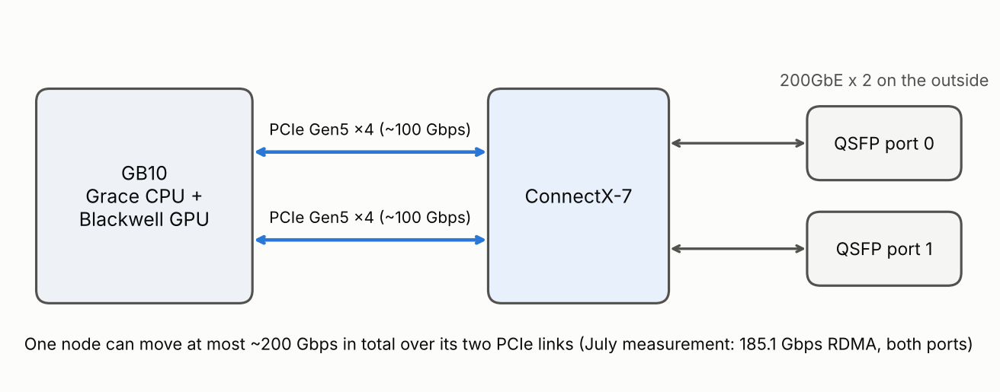
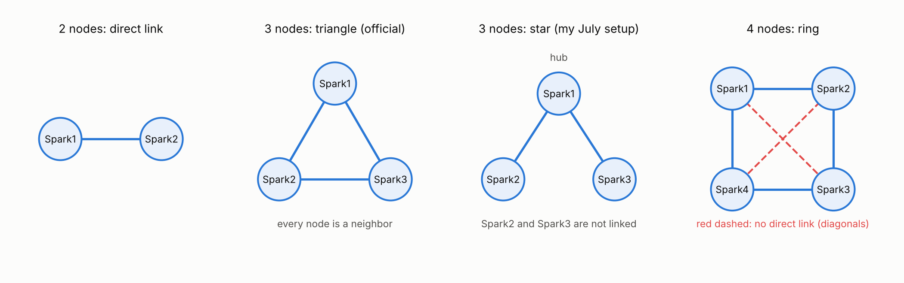
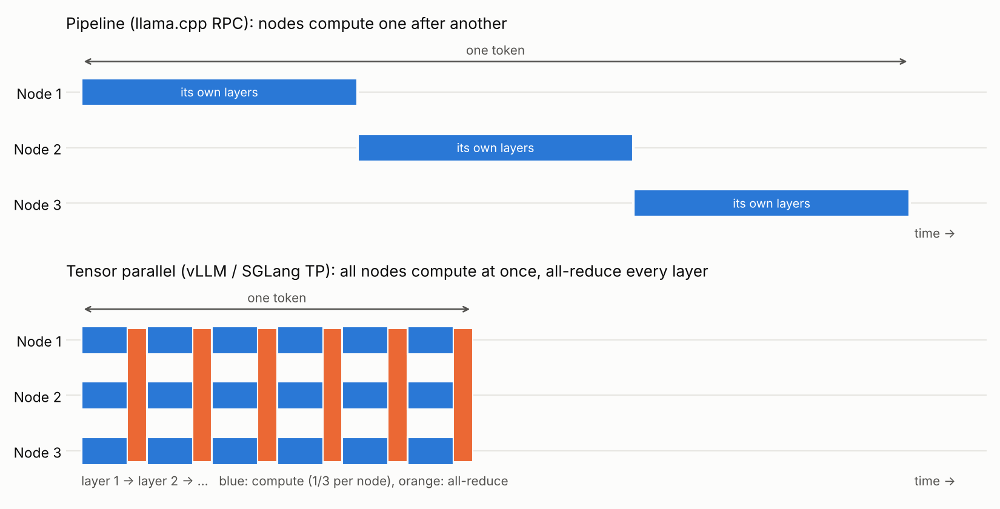
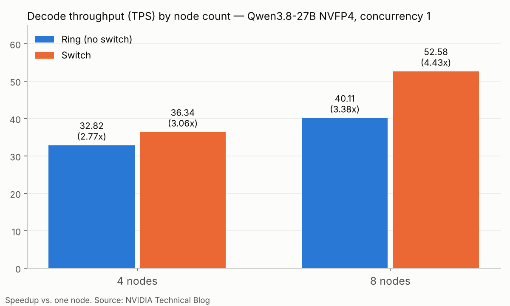

# dgx-spark-ring-rdma

**What does a switchless DGX Spark ring actually do — and how far is it worth scaling?**

A write-up that reads NVIDIA's DGX Spark ring clusters (up to the SC26 **DGX Spark HPC
Developer Kit**) against my own RDMA measurements on two DGX Sparks from July 2026, public
NVIDIA material, and community reports.

Japanese version (Qiita): https://qiita.com/nabe2030/items/95d5d1635fdd29abcf5b

---

## TL;DR

- Multi-node DGX Spark is built on **RDMA (RoCEv2)**. Over plain TCP the Grace CPU becomes the
  bottleneck and the link is wasted.
- The "200GbE" ConnectX-7 is really **two ~100 Gbps halves** behind two PCIe Gen5 x4 links.
  One node can move **~200 Gbps in total**, however many QSFP ports you cable. My July
  measurement: **185.1 Gbps** RDMA over both ports.
- Switchless clusters used to stop at **three** nodes because three nodes in a ring form a
  triangle: everyone is a direct neighbor. From four nodes on, diagonal nodes are not
  neighbors, and **RDMA cannot be relayed by Linux IP routing**.
- My reading of how NVIDIA makes rings of 4+ nodes work: not a software switch or router, but
  **having NCCL talk only to direct neighbors** — which is all a ring all-reduce needs. That
  is an inference from public material; NVIDIA has not published the details.
- Rings help tensor-parallel all-reduce. Traffic that needs every node to talk to every
  node (MoE expert-parallel all-to-all, MPI-style patterns) still wants a **switch**,
  according to NVIDIA itself.
- You can cable any number of nodes into a ring, but the **speedup flattens out**: on a ring,
  going from 4 to 8 nodes adds only +22% decode in NVIDIA's own numbers. Beyond that,
  replicating 4- or 8-node groups and load-balancing requests usually wins.

---

## How we got here

| When | What NVIDIA announced |
|---|---|
| March 2026 (GTC) | Clustering goes from 2 to **4 nodes**; 4 nodes go through a switch |
| June 2026 | NCCL 2.30u1 supports a **3-node ring** (no switch) |
| October 20–22, 2026 (GTC Berlin) | Up to **8 nodes / 1 TB**, manual configuration for now |
| October 22, 2026 (Technical Blog) | Ring vs. switch measured at **4 and 8 nodes** — an 8-node ring is already in the data |
| November 16, 2026 (SC26) | **DGX Spark HPC Developer Kit**: a 4-node ring packaged for researchers |

So the SC26 kit is not where rings beyond three nodes first appeared — NVIDIA's October
technical blog already measured an 8-node ring. What SC26 adds is a **4-node ring presented as
an HPC development kit** for researchers, academics and developers.

---

## 1. The SC26 announcement

From NVIDIA's blog post *"NVIDIA DGX Spark Developer Kit Turns a Desk Into a Supercomputing
Lab"*:

| Item | Detail |
|---|---|
| Name | DGX Spark HPC Developer Kit |
| Audience | Researchers, academics and developers |
| Topology | Four DGX Spark systems, each connected directly to its two neighbors in a ring over ConnectX-7; no network switch |
| Scale | 512 GB memory, 20 TB storage in total |
| Models | Up to ~700B parameters (e.g. DeepSeek V4.1 with NVFP4) |
| Software | An NVIDIA HPC SDK installation playbook is "coming soon" |
| Example uses | Scientific applications, e.g. fine-tuning OpenFold3 |
| Where | Shown at SC26, Chicago, November 15–20, 2026 |

Neither the blog nor NVIDIA's social posts mention RDMA, but every multi-node DGX Spark setup
rests on it, and the ring does too.

One tension worth noting: the kit is pitched at **HPC**, while NVIDIA's own technical blog says
MPI-like communication patterns need a switch. How much of a typical HPC workload runs well on
a 4-node ring is still an open question.

---

## 2. ConnectX-7 and RDMA on DGX Spark (my July measurements)

Full details: [nabe2030/dgx-spark-2node-rpc](https://github.com/nabe2030/dgx-spark-2node-rpc)
(two DGX Sparks running a 228.5 GB GLM-5.2 GGUF over `llama.cpp` RPC, RDMA vs. TCP).

### "200GbE" is two ~100 Gbps halves



Each DGX Spark has two QSFP ports on its ConnectX-7, but the NIC hangs off the GB10 SoC through
**two PCIe Gen5 x4 links of ~100 Gbps each**.

| Test (two nodes, direct link) | Result |
|---|---|
| iperf3 TCP, 1 stream | 29.2 Gbps / 45.1 Gbps (one direction / the other) |
| iperf3 TCP, 8 streams | 106.4 Gbps |
| ib_write_bw RDMA, 1 session | 109.1 Gbps |
| ib_write_bw RDMA, both ports | 185.1 Gbps |

A single flow tops out around 110 Gbps, and both halves together reach ~185 Gbps. That is the
ceiling for **one node's total traffic**, whichever ports you use.

Note for mixed clusters: on the ASUS Ascent GX10, the second ConnectX-7 PCIe link has been
reported to negotiate Gen5 **x2** instead of x4, halving that side.

### Without RDMA, the CPU chokes

Over TCP, receive-side packet processing on the Grace cores becomes the bottleneck. Community
reports show a 4-node NCCL all-reduce at ~2 GB/s over sockets vs. ~23.8 GB/s with RDMA.

In July I compared RDMA and TCP for `llama.cpp` RPC:

- GPT-OSS-120B: long-prompt processing +45%, decode +15–17%
- GLM-5.2: long-prompt processing +3.75%, decode +1.86%
- Two concurrent requests: output throughput +3.1%

The RDMA gain depends on model size, prompt length, generation length and concurrency, and
shrinks as GPU compute dominates.

I also tried TensorRT-LLM (`Qwen3-235B-A22B-FP4`, `tp=2`). It ran with Socket fallback,
but NCCL over RoCE directly failed with `ibv_reg_mr_iova2` errors. Getting NCCL onto RDMA is a
recurring stumbling block on DGX Spark.

---

## 3. Why "switchless" used to stop at three nodes



### Three nodes: everyone is a neighbor

NVIDIA's playbooks were 2 nodes direct, 3 nodes in a ring, and 4 nodes through a switch. Three
nodes in a ring form a **triangle**, so each node is directly linked to both others. Nothing
needs to be relayed.

In July I noted that a 3-node **star** (one hub, two leaves) can also be built without a switch.
But the official layout is the triangle, and the difference matters for tensor parallelism
(section 5).

### Four nodes: the diagonals are not neighbors

In a 4-node ring, Spark1 and Spark3 (and Spark2 and Spark4) have no direct link. Community
reports show:

- Stock NCCL tries to set up RDMA queue pairs between **non-adjacent** ranks too, and fails
  before any collective runs.
- In a 6-node ring, relaying through intermediate nodes with **IP forwarding** failed at RDMA
  connection setup (`ibv_modify_qp`).

RDMA lets NICs read and write each other's memory without going through the kernel, so the
Linux routing table cannot relay it. Nothing on the DGX Spark side acts as a switch or router
for RDMA to a non-adjacent node.

### A community workaround

"SparkRing" on the NVIDIA Developer Forums runs GLM 5.2 on a 4-node switchless ring:

- RDMA only between direct neighbors
- Traffic that would need a non-adjacent link is decomposed and relayed in software
- Custom tensor-parallel all-reduce and related paths, with a ring-only patched NCCL as the
  fallback for everything else

---

## 4. How NVIDIA makes the ring work (an inference)

NVIDIA has not published how rings of four or more nodes are implemented. This is my reading
of the public material.

### What NVIDIA has published, and what the community reports

- **NVIDIA's own numbers say 4- and 8-node rings run.** Its October technical blog
  reports tensor-parallel results on physical rings of 4 and 8 nodes (section 6). These are
  NVIDIA's published figures, not independently reproduced.
- **Community reports say stock NCCL does not.** On 4- and 6-node rings, stock NCCL fails
  while setting up connections to non-adjacent nodes (section 3).
- So NVIDIA evidently has an NCCL setup that works on rings of 4+ nodes, but it has not
  published which NCCL version or settings it uses. The public playbooks still cover only a
  3-node ring and a 4-node switched cluster.
- The 3-node ring playbook uses a 3-node-ring NCCL branch from an NVIDIA developer.
- In ring mode, the community tool sparkrun sets `NCCL_IB_SUBNET_AWARE_ROUTING=1`,
  `NCCL_IB_MERGE_NICS=0`, etc. Despite the name, this makes NCCL pick the NIC on the **same
  subnet** as the peer — i.e. the direct link. It does not forward packets.
- NVIDIA's technical blog says that at four nodes NCCL uses ring-based algorithms for
  tensor-parallel communication by default, so a switchless ring "aligns with traffic flows".
- The same blog says that scaling to eight nodes, splitting a cluster, all-to-all and MPI-like
  patterns need a switch.

### Inference

A ring all-reduce only ever talks to direct neighbors. So the core of NVIDIA's approach is most
likely **making NCCL build connections only between neighbors**. It looks less like a software
switch and more like **limiting who talks to whom so that neighbors are enough**. This
works for a ring of any size, not just four nodes.

Because NVIDIA still says all-to-all needs a switch, I suspect there is no general mechanism
for relaying RDMA to non-adjacent nodes.

### Still unknown

- What happens when a workload needs a non-adjacent peer (an error, or a software relay?)
- Whether a dedicated NCCL or driver ships with the kit or arrives in a DGX OS update
- How far MoE expert parallelism (heavy all-to-all) can go on a ring

---

## 5. What actually gets faster when you distribute



*Schematic: same total compute in both panels; in tensor parallel each node does 1/3 per layer.*

### Pipeline (`llama.cpp` RPC): one node at a time

`llama.cpp` RPC splits the model's layers across nodes. The other nodes don't just lend memory —
they compute their own layers. But for one token, the work passes node 1 → node 2 → node 3, so
**only one GPU is busy at any moment**. More nodes let you load bigger models; single-request
speed stays at one node's speed.

### Tensor parallel: every node at once

With tensor parallelism (vLLM / SGLang TP), every layer is split across all nodes, which compute
together and combine results with an all-reduce each layer. Decode is memory-bandwidth bound,
so using every node's bandwidth at once (273 GB/s × N) makes it faster. In NVIDIA's numbers
(Qwen3.8-27B NVFP4, concurrency 1), a 4-node ring decodes at 32.82 TPS, **2.77×** one node.

### For decode, latency matters more than bandwidth

The per-layer all-reduce during decode is small, so **latency** dominates rather than bandwidth.
RDMA's ~1–3 µs is the big win over TCP. Bandwidth matters more for prefill, which moves much
more data. An 8-node community build found single-stream decode changed by only ±3% when link
bandwidth changed — it was bound by LPDDR5X memory bandwidth.

### Tensor-parallel caveats

- **Divisibility:** TP needs the number of attention heads (and KV heads) to divide by the node
  count. Most models use powers of two, so **TP=3 often isn't possible**.
- **Topology:** ring all-reduce needs the leaves to talk to each other too. A star does not
  work as-is; this is why the official 3-node layout is a triangle.
- **Quantization format:** my July GLM-5.2 fit on two nodes only because of a very aggressive
  `llama.cpp`-specific quant (`UD-IQ1_M`, ~228.5 GB). vLLM / SGLang TP uses formats such as
  NVFP4, so the same model can be larger and need more nodes.

### Under concurrent load, replicas can win

A 4-node DeepSeek V4 report found that, if requests can be load-balanced, **2 × 2-node
replicas** beat one 4-node TP group on aggregate decode throughput. In July, matching
`--parallel 4` to four concurrent requests gave +87.7% output throughput.

- **Concurrency ≤ 4 (one person):** TP across all nodes is likely faster.
- **Concurrency ≥ 8 (a team or many clients):** if the model fits on one or two nodes,
  replicas usually give more total throughput.

Which wins depends on the model and quantization, so measure both `llama.cpp` and vLLM.

---

## 6. How many nodes are worth it?

You can cable 5, 6, … nodes into a ring. But each extra node cuts per-node compute to 1/N while
a ring all-reduce needs 2(N−1) steps, so communication wait grows linearly with N. Where the
two curves cross, adding nodes stops paying off.

### NVIDIA's measurements



| Topology | Nodes | Prefill (TPS) | Decode (TPS) |
|---|---|---|---|
| Ring | 4 | 4,446 (1.69×) | 32.82 (2.77×) |
| Switch | 4 | 4,556 (1.73×) | 36.34 (3.06×) |
| Ring | 8 | 4,962 (1.88×) | 40.11 (3.38×) |
| Switch | 8 | 5,105 (1.94×) | 52.58 (4.43×) |

*Qwen3.8-27B NVFP4, concurrency 1. The switch rows use NVIDIA's ROCEnante backend, which
applies only to switched clusters.*

Doubling a ring from 4 to 8 nodes adds only **+22%** decode, and the gap to the switch widens at
8 nodes.

### A rough model

Assumptions: 273 GB/s memory bandwidth per node; 60 layers with two all-reduces each; a per-step
all-reduce latency α of 5 µs or 10 µs (an **assumed** value covering RDMA latency plus NCCL /
kernel-launch overhead — not a measurement). Single-request decode, tok/s:

| Model (FP4) | α | 1 | 2 | 4 | 6 | 8 | 10 nodes |
|---|---|---|---|---|---|---|---|
| Dense 70B | 5 µs | 7.8 | 15.3 | 28.0 | 36.5 | 40.9 | 42.3 |
| Dense 70B | 10 µs | 7.8 | 15.0 | 25.5 | 30.0 | 30.5 | 29.1 |
| MoE, 17B active | 5 µs | 32.1 | 59.6 | 87.8 | 89.4 | 81.4 | 71.9 |
| MoE, 17B active | 10 µs | 32.1 | 55.7 | 66.7 | 58.2 | 48.3 | 40.5 |

Very simplified, but the shape is clear:

- A dense model that reads a lot of weights per token flattens out around **6–8 nodes**.
- An MoE with few active parameters peaks around **4 nodes** and gets **slower** beyond that.

### Limits other than speed

1. **TP divisibility:** in practice TP is 2, 4 or 8. With 8 KV heads (common), going past 8 means
   KV replication or mixing in pipeline parallelism, which costs efficiency.
2. **All-to-all:** MoE expert parallelism over a ring needs up to N/2 relay hops.
3. **Capacity:** the real reason to add nodes is memory. Even a 1T-parameter model is ~500 GB
   in FP4, which fits in 4–8 nodes.
4. **Fragility:** one cable or one node down stops the whole ring, and the odds grow with N.

### Rule of thumb

- **Ring:** speedup flattens out around **4 nodes**. That's where the returns stop, not a cap
  on how many nodes you can cable.
- **Switch:** worthwhile up to **8 nodes**.
- **Beyond that:** replicate 4- or 8-node groups and load-balance requests rather than splitting
  one model further.

---

## Summary

- Multi-node DGX Spark is RDMA (RoCEv2) first; TCP leaves the link CPU-bound.
- "200GbE" means ~200 Gbps **per node in total** (two ~100 Gbps halves). My July 185.1 Gbps
  matches.
- Switchless stopped at three nodes because a triangle is fully connected. At four, the
  diagonals are not neighbors, and RDMA cannot be relayed by kernel routing.
- NVIDIA's ring support most likely works by keeping NCCL to neighbor-only connections,
  which fits ring all-reduce. Workloads that need every node to talk to every other node
  still want a switch.
- Speedup flattens around 4 nodes on a ring and around 8 with a switch; past that, replicate.

---

## References

- NVIDIA Blog — [NVIDIA DGX Spark Developer Kit Turns a Desk Into a Supercomputing Lab](https://blogs.nvidia.com/blog/dgx-spark-hpc-developer-kit-sc26/) (Nov 16, 2026)
- NVIDIA Technical Blog — [Running Frontier-Class AI Models Across 8 NVIDIA DGX Spark Nodes](https://developer.nvidia.com/blog/?p=123934) (Oct 22, 2026)
- NVIDIA — [Connect Three DGX Spark in a Ring Topology](https://build.nvidia.com/spark/connect-three-sparks)
- NVIDIA — [NCCL for Multiple Sparks](https://build.nvidia.com/spark/nccl/overview.md)
- My July measurements — [nabe2030/dgx-spark-2node-rpc](https://github.com/nabe2030/dgx-spark-2node-rpc)
- NVIDIA Forums — [6-Node DGX Spark Ring Topology - NCCL Fails on Non-Adjacent Node Pairs](https://forums.developer.nvidia.com/t/6-node-dgx-spark-ring-topology-nccl-fails-on-non-adjacent-node-pairs-routed-rdma/377435)
- NVIDIA Forums — [GLM 5.2 on 4x GB10s - Switchless Ring](https://forums.developer.nvidia.com/t/glm-5-2-on-4x-gb10s-switchless-ring-22-tps-coding/378451)
- NVIDIA Forums — [Three-node Spark clusters without a switch in spark-vllm-docker and sparkrun](https://forums.developer.nvidia.com/t/three-node-spark-clusters-without-a-switch-are-now-supported-in-spark-vllm-docker-and-sparkrun/365296)
- NVIDIA Forums — [ConnectX-7 200GbE via MikroTik CRS812](https://forums.developer.nvidia.com/t/connectx-7-200gbe-via-mikrotik-crs812-qsfp-dd-400g-2xqsfp56-200g-breakout/357162)
- NVIDIA Forums — [Two multi-node DGX Spark wins: RoCE 2× inference throughput](https://forums.developer.nvidia.com/t/two-multi-node-dgx-spark-wins-roce-2x-inference-throughput-qwen3-5-397b-a17b-nvfp4-serving-with-sm121-cutlass-patch/366325)
- NVIDIA Forums — [8x DGX Spark Cluster Build Report](https://forums.developer.nvidia.com/t/8x-dgx-spark-cluster-build-report-crs812-400dd-4x100g-breakouts-nemotron-3-ultra-at-tp-8/373146)
- NVIDIA Forums — [4-node DGX Spark Cluster with DeepSeek V4 flash](https://forums.developer.nvidia.com/t/4-node-dgx-spark-cluster-with-deepseek-v4-flash-0731-dspark-benchmark-prefill-2-500-t-s-decode-90-t-s/378878)
- NVIDIA Forums — [ASUS Ascent GX10 — Second ConnectX-7 PCIe slot wired at Gen5 x2](https://forums.developer.nvidia.com/t/asus-ascent-gx10-second-connectx-7-pcie-slot-wired-at-gen5-x2-instead-of-x4-50-bandwidth-loss-vs-dgx-spark-fe/367853)
- Notebookcheck — [Nvidia's DGX Spark can now join forces with seven others](https://notebookcheck.net/Nvidia-s-DGX-Spark-can-now-join-forces-with-seven-others-to-deliver-1-TB-of-memory.1430472.0.html) (GTC Berlin)
- ChatForest — [DGX Spark June 2026 update: multi-node clustering](https://chatforest.com/builders-log/nvidia-dgx-spark-june-2026-update-multi-node-clustering-nvfp4-nemoclaw-builder-guide/) (3-node ring, NCCL 2.30u1)
- MONOist — [DGX Spark goes to 4-node clustering (GTC 2026, Japanese)](https://monoist.itmedia.co.jp/mn/articles/2603/19/news046.html)

---

## Repository layout

```
dgx-spark-ring-rdma/
├── README.md               # this write-up
├── docs/figures/           # figures (PNG for display, SVG source)
└── scripts/make_figures.py # regenerates the figures
```

## License

MIT — see [LICENSE](LICENSE).
